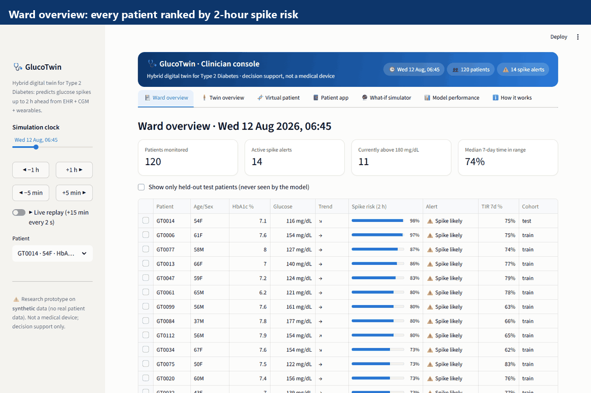
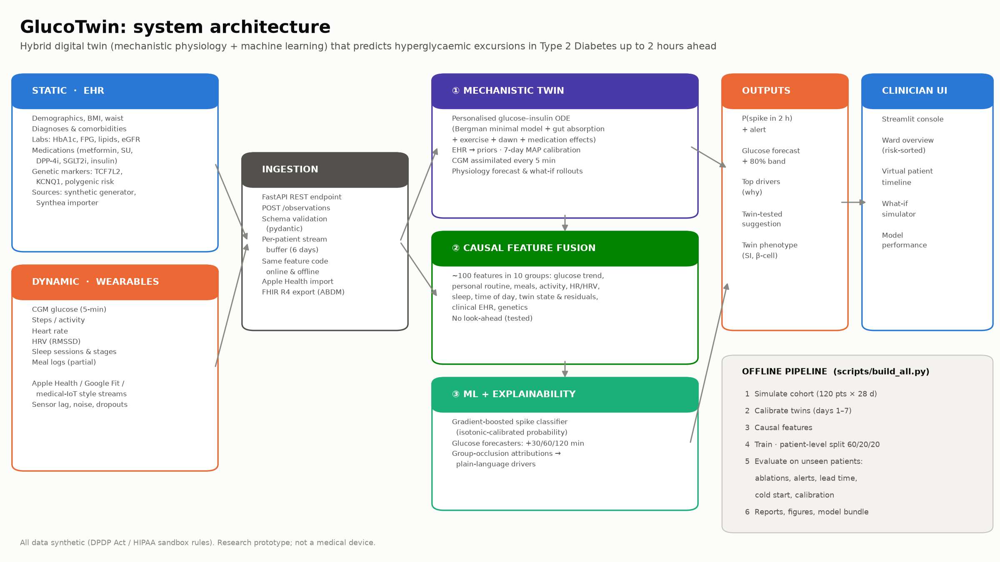

# GlucoTwin: a hybrid digital twin that predicts glucose spikes and lows in Type 2 Diabetes

 
 -eb6834)


> **Digital Twin Challenge 2026 · Happiest Health · Reimagining & Reforming Healthcare in India Summit**
>
> GlucoTwin keeps a **personalised physiological twin** of each person with Type 2 Diabetes in sync with their
> **health record** and **live wearables** (CGM, steps, heart rate, HRV, sleep, meals). It:
> - warns of a **glucose spike up to ~1 hour before it happens** and of **dangerous lows**;
> - explains **why**;
> - lets the doctor and patient test **"what if"** on the patient's own simulated body.

**▶ Live demo:** `<add your Streamlit Cloud link (docs/DEPLOY.md)>` · **🎥 Video:** `<add your YouTube link>`



## At a glance

<!-- GLANCE:START -->
| | Synthetic cohort (24 unseen patients) | Real patients (ShanghaiT2DM) |
|---|---|---|
| **Spike prediction (AUROC)** | **0.952** | **0.888** (96 people) |
| Gain over CGM alone (95% CI) | +0.020 (+0.013 to +0.026) | +0.020 (+0.012 to +0.031) |
| Spikes warned in advance · median warning | 82% · 75 min | 55% · 65 min (untuned threshold) |
| 30-min forecast error: ours vs 'no change' | 13.5 vs 25.5 mg/dL | 10.4 vs 16.4 mg/dL |
| Model trained only on synthetic data, applied to real patients | | AUROC 0.842 |
| **Low-glucose (<70) prediction (AUROC)** | (too rare in simulation) | **0.901** (classic rule 0.842) |
| Lows warned with ≤ 0.25 false alarms/day | | GlucoTwin 74% vs best rule setting 61% |
| Lows warned with ≤ 1.00 false alarms/day | | GlucoTwin 94% vs best rule setting 97% |
<!-- GLANCE:END -->

## Why GlucoTwin is different

1. **A real twin, not just a classifier.** Each patient gets a personalised glucose–insulin physiology model:
   - it starts from the EHR and is calibrated on their first week;
   - it is kept in sync with every CGM reading;
   - it powers "what if" simulation that a black-box model cannot do.
2. **Validated on real patients, not only synthetic ones.** 96 people with T2D (ShanghaiT2DM, CC BY 4.0), with
   person-grouped cross-validation, bootstrap confidence intervals, and a model trained purely on synthetic data
   tested zero-shot.
3. **Both directions of danger.** Spikes (high glucose) *and* hypoglycaemia (lows, trained on real patients), with
   alerts scored the way a phone notification would be: spikes caught, warning time, false alarms per day.
4. **Built for India.**
   - **Data and simulator:** Indian meal presets (rice + sambar, ragi mudde, dosa, biryani) and Indian diet
     patterns in the simulator.
   - **Patient app:** a Hindi/English patient phone screen.
   - **Interoperability:** FHIR R4 export (ABDM's exchange standard).
5. **Honest science.** We report what did *not* work: twin features add no accuracy; static EHR slightly hurt on
   real data; the physics-only twin forecasts worse than "no change" on real patients. Expert reviewers can trust
   the numbers.
6. **Product-grade engineering.**
   - real-time API with a new-patient lifecycle (register → stream → calibrate → assess → FHIR);
   - Synthea and Apple Health importers;
   - pytest suite with no-look-ahead and online/offline parity tests;
   - one-command rebuild; Docker.



---

## 1. Team details

| | |
|---|---|
| **Team name** | Twin |
| **College** | KIIT (Kalinga Institute of Industrial Technology), Bhubaneswar |
| **Team leader** | Chinmaya Biswal (contact details shared on the Unstop submission) |
| **Members** | Chinmaya Biswal · Manish Sarkar · Mishti Ghosh |

## 2. Project title

**GlucoTwin: Hybrid Physiological–ML Digital Twin for Early Prediction of Glucose Spikes in Type 2 Diabetes**

## 3. Problem statement and healthcare use case

**Condition.** Type 2 Diabetes (T2D). India has an estimated **101 million** adults with diabetes and **136 million**
with prediabetes (ICMR-INDIAB, 2023).

**Problem.** T2D care is reactive:
- HbA1c is measured every ~3 months, averaging away the daily post-meal spikes that high-carbohydrate Indian
  diets cause. Those spikes are associated with vascular damage even when HbA1c looks acceptable.
- Continuous glucose monitors (CGMs) show what has *already* happened.
- Clinicians have no way to ask "what would happen if this patient walked after dinner, or switched from white
  rice to ragi?"

**Adverse event predicted.** A **hyperglycaemic excursion**: CGM glucose rises **above 180 mg/dL** (the ADA
time-above-range threshold) **and at least 40 mg/dL above its current level** within the next **120 minutes**,
while the patient is currently in range.

**Second adverse event:** **hypoglycaemia**, CGM below **70 mg/dL** within the next 2 hours. This model is trained and validated on real patients.

**Use case.**
1. A clinician (or care coordinator) sees a **risk-sorted ward view** of remotely monitored patients.
2. Opening a patient shows their **virtual twin**: live CGM, a 2-hour forecast, spike probability, the **drivers**
   behind it (routine, meals, sleep, stress signals, twin physiology) and a **twin-tested suggestion**, e.g.
   "a 15-minute brisk walk now lowers the predicted peak by ~20 mg/dL".
3. In the **what-if simulator**, the doctor and patient explore meal choices (Indian meal presets), carbohydrate
   quality, post-meal walks and sleep on the patient's own calibrated physiology.

## 4. Technical stack and AI/ML model details

**Stack:** Python 3.11+ · NumPy · pandas · SciPy · **Numba** (ODE kernels) · **scikit-learn**
(HistGradientBoosting, isotonic calibration) · **FastAPI** + Uvicorn (real-time API) · **Streamlit** + **Plotly**
(clinician dashboard) · Matplotlib · python-pptx · pytest.

### The three layers

| Layer | What it does | Details |
|---|---|---|
| **① Mechanistic twin** | A personalised, physiologically interpretable replica of the patient | Bergman minimal model extended with endogenous insulin secretion (β), two-channel gut absorption (fast/slow GI), exercise uptake + post-exercise insulin sensitivity, dawn phenomenon, and medication effects: metformin, sulfonylurea, DPP-4i, SGLT2i, basal insulin. **EHR → priors**; the **onboarding week** (days 1–7) personalises insulin sensitivity, β-cell response, basal glucose and dawn amplitude by MAP estimation (Nelder–Mead, Huber loss on 30/60-min forecasts). **CGM is assimilated every 5 min** to keep the twin in sync. |
| **② Causal feature fusion** | Fuses static + dynamic data into ~100 features | 10 groups: glucose trend, personal routine (what happened at this time on previous days), logged meals, activity, HR & HRV, sleep, time of day, **twin state & residuals** (e.g. "glucose is 28 mg/dL above what the twin expects" signals an unlogged meal), clinical EHR, genetics. All features are strictly causal (unit-tested). |
| **③ ML + explainability** | Predicts and explains | Gradient-boosted classifier → isotonic-calibrated **P(spike in 2 h)**; gradient-boosted forecasters for glucose at +30/60/120 min with 80% intervals; **group-occlusion attributions** rendered as plain-language drivers. |

### Data (sandbox rules)

No real patient data is used. `glucotwin/simulate.py` generates a **causally consistent synthetic cohort** of
120 Indian T2D patients × 28 days at 5-minute resolution (≈1M rows):

- **Static EHR:** age, sex, city, BMI, waist, diabetes duration, HbA1c, FPG, lipids, eGFR, BP, comorbidities,
  6 drug classes, TCF7L2 rs7903146 / KCNQ1 rs2237892 risk alleles, polygenic risk score, family history, diet staple.
- **Dynamic wearables:** CGM (interstitial lag, ~7% MARD, AR noise, sensor change, dropouts), steps, heart rate,
  HRV (RMSSD, daytime gaps), sleep sessions and stages, partial meal logs (~⅓ of meals unlogged, with portion
  errors).
- **Causal generation:** demographics + genetics + meds → physiology parameters; habits → meals, walks, sleep,
  stress; the ODE gives true glucose; true glucose → CGM *and* EHR labs. HbA1c in the EHR therefore agrees with
  CGM-derived GMI (r ≈ 0.9).
- **Hidden drivers** the model must infer: unlogged meals, stress episodes (visible only as HR↑/HRV↓), and sleep
  debt (next-day insulin resistance).

### Real-patient validation (open data)

The main results above are synthetic. To check them on real patients we use **ShanghaiT2DM**:
- **What it contains:** 100 people with T2D, 109 CGM recordings of about 3–14 days, a clinical record, meals, and
  insulin/oral-drug doses.
- **Source and license:** Zhao Q, Zhu J, Shen X *et al.*, "Chinese diabetes datasets for data-driven machine
  learning", *Scientific Data* 10, 35 (2023); figshare DOI 10.6084/m9.figshare.20444397; **CC BY 4.0**.
- **Not redistributed here:** download it with the script below.
- **Importer:** `glucotwin/realdata.py` converts units (HbA1c IFCC→NGSP, lipids mmol/L→mg/dL), maps free-text
  medicines to drug classes, estimates carbs from the meal descriptions, and parses insulin doses. These feed the
  twin through a subcutaneous insulin depot.

```bash
python scripts/download_real_data.py     # ~3.4 MB -> data/external/shanghai/
python scripts/validate_real_data.py     # grouped 5-fold CV, ablation, bootstrap CIs, zero-shot transfer
```

### Evaluation methodology

- **Patient-level split** 60/20/20 (72 train / 24 validation / 24 **test patients never seen in training**).
- The twin is calibrated **only on days 1–7**. Before that it runs on EHR priors ("cold start"), as it would in
  deployment.
- Alerts are evaluated as **real notifications**:
  - fired on a rising edge and repeated hourly while risk stays high;
  - *true* if a spike follows within 2 h;
  - a spike counts as *caught* if a notification preceded it within 2 h.
- Alert thresholds are chosen on validation patients.
- **Ablations** isolate the value of each data stream. Two baselines are included: a CGM linear-extrapolation
  rule, and the mechanistic twin alone.

### Results (24 unseen test patients)

<!-- RESULTS:START -->
| Model (test = 24 unseen patients) | AUROC | AUPRC | Spikes caught ≤2 h ahead | Median warning | Alert precision | False alerts / day |
|---|---|---|---|---|---|---|
| Wearables only (dynamic) | 0.954 | 0.895 | 83% | 80 min | 83% | 0.86 |
| Fusion: EHR + wearables | 0.953 | 0.893 | 79% | 75 min | 86% | 0.61 |
| **GlucoTwin: fusion + digital twin** | 0.952 | 0.893 | 82% | 75 min | 84% | 0.77 |
| CGM only | 0.933 | 0.846 | 75% | 75 min | 81% | 0.87 |
| Static EHR + time of day | 0.899 | 0.774 | 78% | 85 min | 66% | 1.94 |
| Mechanistic twin only (no ML) | 0.590 | 0.480 | 56% | 40 min | 71% | 0.75 |
| Rule: 30-min linear extrapolation | 0.560 | 0.364 | 71% | 10 min | 69% | 0.85 |

| Glucose forecast RMSE (mg/dL) | +30 min | +60 min | +120 min |
|---|---|---|---|
| GlucoTwin hybrid | 13.5 | 21.4 | 25.7 |
| Hybrid without twin features | 13.5 | 21.3 | 25.5 |
| Mechanistic twin | 27.1 | 36.4 | 45.4 |
| Persistence (no change) | 25.5 | 41.2 | 53.2 |

| AUROC difference: GlucoTwin minus … | Difference | 95% CI (patient bootstrap, 200×) |
|---|---|---|
| Static EHR + time of day | +0.053 | +0.036 to +0.068 |
| CGM only | +0.020 | +0.013 to +0.026 |
| Wearables only (dynamic) | -0.001 | -0.003 to +0.001 |
| Fusion: EHR + wearables | -0.000 | -0.001 to +0.001 |

**Real patients: ShanghaiT2DM** (96 people with T2D, 105 recordings, 5-fold cross-validation grouped by person, spike rate 10.8%):

| Model (real data) | AUROC | AUPRC | Spikes caught | Median warning | False alerts / day |
|---|---|---|---|---|---|
| CGM only | 0.868 | 0.459 | 60% | 65 min | 1.13 |
| + personal routine | 0.891 | 0.527 | 61% | 70 min | 1.01 |
| + meals & insulin doses | 0.895 | 0.535 | 62% | 70 min | 1.00 |
| + EHR (clinical record) | 0.887 | 0.527 | 54% | 70 min | 0.77 |
| GlucoTwin (+ digital twin) | 0.888 | 0.521 | 55% | 65 min | 0.81 |
| Zero-shot: model trained only on synthetic patients | 0.842 | 0.400 | | | |

| Real-data AUROC difference | Difference | 95% CI (bootstrap over people) |
|---|---|---|
| GlucoTwin (+ digital twin) vs CGM only | +0.020 | +0.012 to +0.031 |
| + meals & insulin doses vs + personal routine | +0.004 | +0.001 to +0.006 |
| + EHR (clinical record) vs + meals & insulin doses | -0.008 | -0.014 to -0.003 |
| GlucoTwin (+ digital twin) vs + EHR (clinical record) | +0.000 | -0.003 to +0.003 |

| Real-data forecast RMSE (mg/dL) | +30 min | +60 min |
|---|---|---|
| Persistence (no change) | 16.4 | 27.8 |
| Calibrated twin (physiology only) | 28.9 | 37.8 |
| GlucoTwin hybrid (ML, out-of-fold) | 10.4 | 20.0 |

_Real-data alerts use a fixed 0.5 probability threshold (no per-cohort tuning)._

**Hypoglycaemia (<70 mg/dL within 2 h), real patients** (96 people, 343 low episodes; thresholds chosen by inner cross-validation):

| Model | AUROC | AUPRC | Lows caught | Median warning | False alerts / day |
|---|---|---|---|---|---|
| CGM only | 0.892 | 0.239 | 64% | 22 min | 0.31 |
| + routine & meals | 0.898 | 0.273 | | | |
| + insulin & oral-agent doses | 0.899 | 0.275 | | | |
| + EHR (incl. medication classes) | 0.905 | 0.298 | | | |
| GlucoTwin (+ digital twin) | 0.901 | 0.294 | 83% | 20 min | 0.35 |
| Deployable (no dose stream) | 0.901 | 0.286 | 79% | 25 min | 0.32 |
| Rule: 'urgent low soon' (30-min extrapolation) | 0.842 | 0.254 | 100% | 45 min | 1.17 |

| Hypo AUROC difference | Difference | 95% CI |
|---|---|---|
| GlucoTwin vs CGM only | +0.009 | +0.001 to +0.019 |
| + doses vs routine & meals | +0.002 | -0.002 to +0.005 |
| + twin vs + EHR | -0.003 | -0.010 to +0.002 |

| AUROC / false alerts per day, by monitoring history | Days 1-2 (cold start) | Days 3-6 (onboarding) | Day 7+ (calibrated twin) |
|---|---|---|---|
| CGM only | 0.932 / 1.06 | 0.937 / 0.67 | 0.933 / 0.89 |
| Wearables only (dynamic) | 0.950 / 1.00 | 0.957 / 0.68 | 0.954 / 0.88 |
| Fusion: EHR + wearables | 0.951 / 0.71 | 0.956 / 0.51 | 0.952 / 0.62 |
| GlucoTwin: fusion + digital twin | 0.953 / 0.98 | 0.956 / 0.57 | 0.952 / 0.78 |
<!-- RESULTS:END -->

Figures are in [`reports/figures/`](reports/figures/): ablations, ROC/PR curves, cold-start performance, lead
times, calibration, forecast error, group importance, twin parameter recovery, and cohort validation.

<!-- TAKEAWAYS:START -->
**Key takeaways (stated with their uncertainty)**
- **Fusing the dynamic streams is what drives accuracy.** Adding meals, activity, sleep, HR/HRV and personal routine to CGM raises AUROC from 0.933 to 0.954. GlucoTwin vs CGM-only: +0.020 (95% CI +0.013 to +0.026). False alarms fall from 0.87 to 0.77 per patient-day.
- **GlucoTwin warns about 82% of excursions, with a median 75 minutes' notice.** 84% of its alerts are followed by a real excursion.
- **Static EHR and twin features add no measurable discrimination once wearable history exists.** All differences fall within ±0.003 AUROC. A data-efficiency experiment (`scripts/experiment_data_efficiency.py`, 6–72 training patients) found no gain from the twin either, in this synthetic setting.
- **What the twin does provide is what a purely statistical model cannot:**
  - *counterfactual* what-if simulation (meal, carbohydrate quality, post-meal walk, sleep) from the patient's current physiological state;
  - an interpretable phenotype;
  - twin-tested suggestions, such as how much a walk now would lower the peak.
- **The twin recovers hidden physiology** from one week of data, measured against the simulator's ground truth. Correlation with the true value, EHR priors → calibrated twin:
  - insulin sensitivity: r = 0.73 → **0.78**
  - β-cell response: r = 0.54 → **0.68**
  - basal glucose: r = 0.87 → **0.92**
- **The ML forecaster roughly halves glucose-forecast error** versus the physiology-only twin or a 'no change' guess (13 / 21 / 26 mg/dL RMSE at +30 / 60 / 120 min).
- **Validated on 96 real people with T2D (ShanghaiT2DM).** The fusion gain over CGM alone replicates: +0.020 AUROC (95% CI +0.012 to +0.031). The best real-data configuration is *+ meals & insulin doses* (AUROC 0.895). The model trained only on synthetic patients reaches 0.842 without seeing any real data.
- **On real data the static EHR slightly hurt** (-0.008, CI -0.014 to -0.003), likely over-fitting with ~80 training people. Twin features were neutral (+0.000). The **physiology-only twin forecast was worse than 'no change'** (29 vs 16 mg/dL at +30 min): its dynamics are too fast for these closely managed patients. The hybrid ML forecaster was best (10 mg/dL).
- **Lows too, on real patients.** A hypoglycaemia model trained on 96 real people (343 lows) reaches AUROC 0.901, versus 0.842 for the classic 'urgent low soon' rule and +0.009 over CGM alone (CI +0.001 to +0.019). The alarm trade-off is mixed. When alarms must be rare (≤0.25/day), GlucoTwin warns of 74% of lows vs 61% for the best rule setting. At ≤1 alarm/day the simple rule wins (97% vs 94%). Our design therefore keeps the rule as a safety net for imminent lows and uses GlucoTwin for quieter, earlier heads-ups. Insulin/oral-agent dose data changed AUROC by +0.002 (CI -0.002 to +0.005), so the deployable model works without them.
<!-- TAKEAWAYS:END -->

## 5. Demo video (20+ minutes)

**Video:** `<unlisted YouTube link>`. The recording script and timings are in [`docs/video_script.md`](docs/video_script.md).

## 6. Open-source license

[MIT License](LICENSE). All dependencies are permissively licensed (BSD / MIT / Apache-2.0).

## 7. Architecture diagram

[`docs/architecture.pdf`](docs/architecture.pdf) (also [`docs/architecture.png`](docs/architecture.png)).

## 8. Presentation

[`docs/GlucoTwin_presentation.pptx`](docs/GlucoTwin_presentation.pptx) · [`docs/GlucoTwin_presentation.pdf`](docs/GlucoTwin_presentation.pdf)

---

## Quick start

### One-click run (no setup)

The trained models and demo data are already in the repo, so the dashboard runs without rebuilding anything.

1. Install **Python 3.11–3.13** from <https://www.python.org/downloads/>. On Windows, tick **"Add python.exe to
   PATH"** on the first installer screen.
2. Clone the repo, or use **Code → Download ZIP** and extract it.
3. **Windows:** double-click **`start.bat`**. **macOS / Linux:** run `bash start.sh`.

The first run creates a private `.venv` and installs the packages, which takes a few minutes. The dashboard then
opens at <http://localhost:8501>. Later runs start in seconds.

### Full pipeline (rebuild everything from scratch)

```bash
pip install -r requirements.txt
python scripts/build_all.py            # simulate → calibrate twins → features → train → evaluate → figures (~6–8 min)
python scripts/make_docs.py            # architecture diagram, presentation, README results table
streamlit run dashboard/app.py         # clinician dashboard → http://localhost:8501
```

Real-time API and streaming replay:

```bash
uvicorn glucotwin.api:app --port 8000                       # Swagger UI at http://localhost:8000/docs
python scripts/replay_stream.py --patient GT0007 --days 10   # streams a patient like a device gateway
```

Tests (physiology sanity, simulator consistency, **no-look-ahead leakage**, alert metrics, **online/offline
feature parity**):

```bash
pytest -q
```

### API

| Method | Endpoint | Purpose |
|---|---|---|
| GET | `/health` | Service status and alert threshold |
| GET | `/patients` | Patients and streaming status |
| GET | `/patients/{id}/twin` | Twin phenotype (insulin sensitivity, β-cell, basal glucose percentiles) |
| POST | `/patients/{id}/observations` | Ingest 5-min records (`timestamp, cgm, steps, hr, hrv_rmssd, in_sleep, sleep_stage, carbs_logged`) |
| GET | `/patients/{id}/assessment` | Spike probability, alert, forecasts with intervals, drivers, twin-tested suggestion |
| POST | `/patients/{id}/what-if` | Simulate a meal / walk / sleep scenario from the current state |
| POST | `/patients` | **Onboard a new patient** from their health record; the twin starts from EHR priors |
| POST | `/patients/{id}/calibrate` | Personalise the twin from the streamed data (≥ 2 days) |
| GET | `/patients/{id}/fhir` | **FHIR R4 Bundle**: Patient, Conditions, Observations, MedicationStatements, RiskAssessment |

### Interoperability: real data in, standard records out

| Direction | Format | How |
|---|---|---|
| EHR in | **Synthea** CSV export (`patients`, `conditions`, `observations`, `medications`) | `interop.ehr_from_synthea()`. Maps SNOMED conditions, LOINC labs and RxNorm medication names to the EHR schema; missing fields (e.g. genetics) stay empty and the models handle them. |
| Wearables in | **Apple Health** `export.xml` (blood glucose from CGM apps, heart rate, HRV, steps, carbs, sleep stages) | `interop.wearables_from_apple_health()`, resampled to the 5-min stream. |
| Records out | **FHIR R4** Bundle (LOINC, SNOMED CT, ATC, UCUM) + `RiskAssessment` for the 2-h prediction | `GET /patients/{id}/fhir`, or the *Download FHIR bundle* button in the dashboard. FHIR R4 is the exchange standard used by India's ABDM. |

```bash
python scripts/interop_cli.py synthea path/to/synthea/csv --register          # onboard patients via the API
python scripts/interop_cli.py apple-health export.xml --patient SY-1a2b3c4d --post
python scripts/interop_cli.py fhir SY-1a2b3c4d --out bundle.json
```

### Run everything with Docker

```bash
docker compose up --build      # dashboard -> http://localhost:8501 · API -> http://localhost:8000/docs
```

## Repository structure

```
glucotwin/
  physiology.py   glucose–insulin ODE kernels (Numba): truth simulator, observer, forecasts, rollouts
  simulate.py     synthetic cohort: EHR, lifestyle, physiology, sensors, labs
  twin.py         PatientTwin: EHR priors, onboarding-week calibration, tracking, what-if, phenotype
  features.py     causal feature fusion (shared by training and the real-time engine)
  modeling.py     classifier/forecasters, ablations, notification-based evaluation, explanations
  engine.py       real-time engine (ingest → assess → what-if)
  api.py          FastAPI service (assessment, what-if, onboarding, calibration, FHIR)
  interop.py      Synthea EHR import · Apple Health import · FHIR R4 export
  realdata.py     ShanghaiT2DM loader (real-patient validation)
  reporting.py    figures
dashboard/app.py  Streamlit clinician console
scripts/          build_all.py · make_docs.py · replay_stream.py · interop_cli.py ·
                  experiment_data_efficiency.py · capture_screenshots.py ·
                  download_real_data.py · validate_real_data.py
tests/            pytest suite (core + interoperability/lifecycle)
Dockerfile, docker-compose.yml
data/raw/         synthetic EHR, wearable streams, hidden ground truth (for validation only)
models/           calibrated twin parameters, trained model bundle
reports/          metrics.json and figures
docs/             architecture, presentation, video script, how-it-works
```

## Limitations

- **Mostly synthetic data.** The real-data check (ShanghaiT2DM) confirms the fusion gain, but:
  - it is a Chinese cohort, much of it closely managed;
  - it has no step, heart-rate, HRV or sleep data;
  - it is far from proof of clinical accuracy for Indian patients. Next step: a prospective Indian CGM + wearable cohort.
- **The physics-only twin forecasts worse than "no change" on real patients.** Its glucose dynamics are tuned to the
  simulated population. The hybrid ML forecaster is what should be used for prediction, and the what-if simulator
  has **not** been validated against real interventions.
- Meal carbohydrates in the real data are estimated from free-text food descriptions; unrecorded meals use a
  nominal 50 g.
- Hypoglycaemia is rare in the simulated cohort, so the low-glucose model is trained and validated only on the real Shanghai cohort (`scripts/hypo_real_data.py`); it has not been tested on Indian patients.
- The dawn-phenomenon parameter is not identifiable from a single week of data.
- Twin features do not improve spike-prediction or forecast accuracy over the fused ML model here; on real data, with more physiological variety than the simulator, this needs re-testing.
- What-if simulations are model estimates intended for counselling and exploration, **not dosing advice**.
- **GlucoTwin is a research prototype and not a medical device.**
